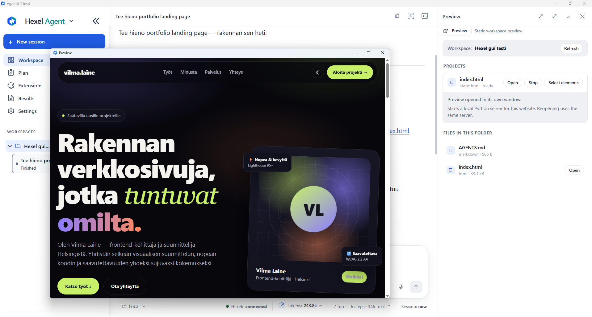
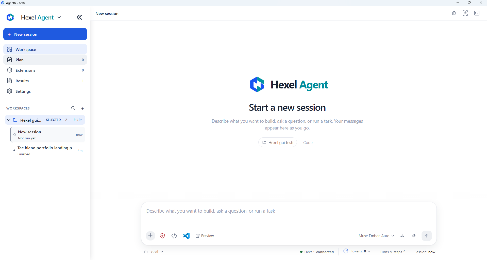
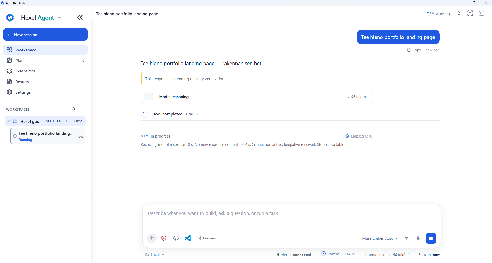
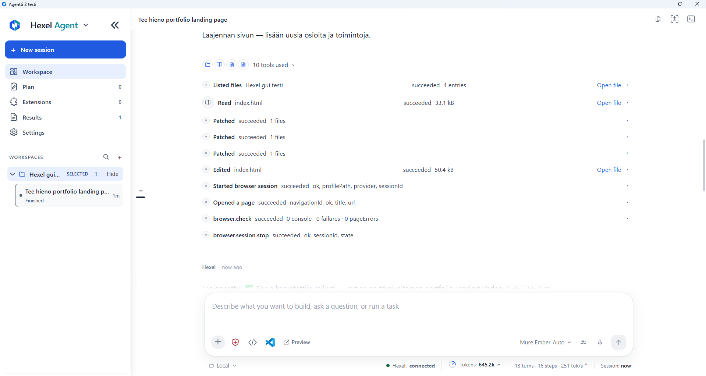
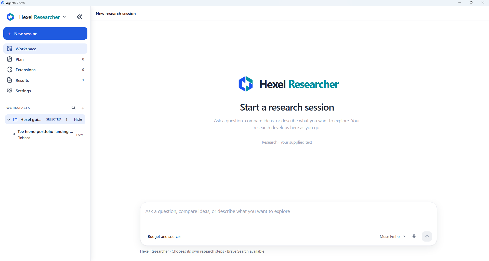
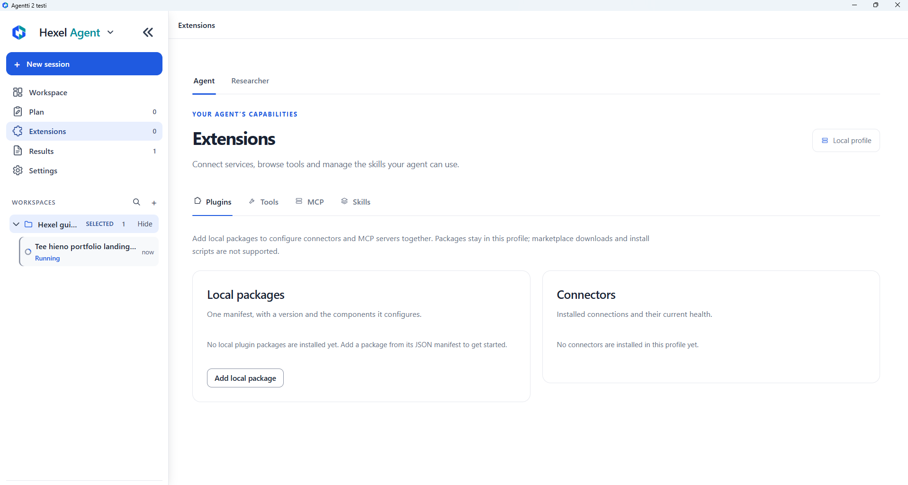
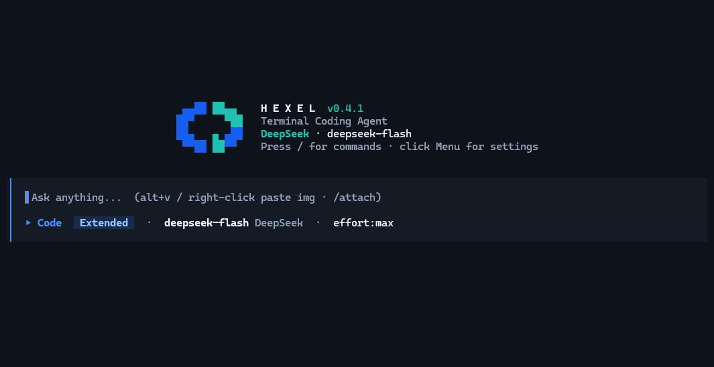
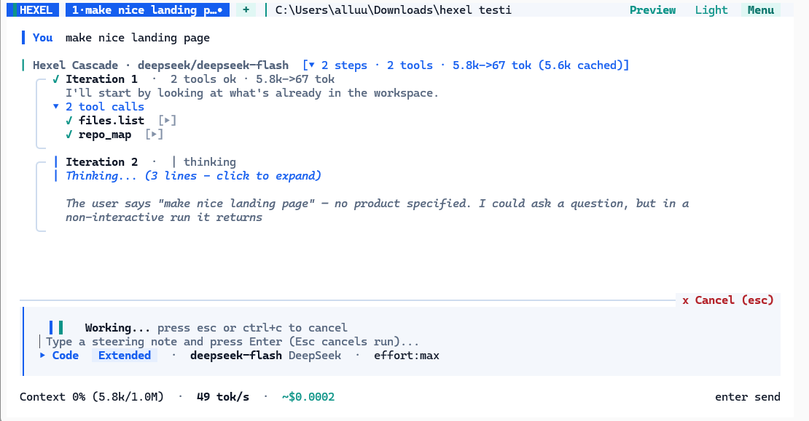
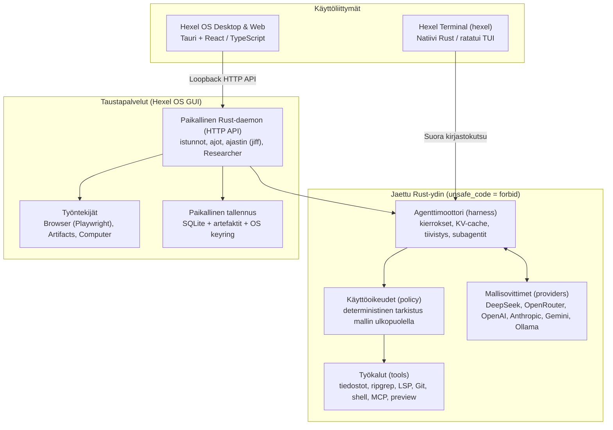

# Hexel OS

**Hexel OS** *(kehityksen alkuvaiheessa nimellä Agent OS)* on paikallisesti toimiva, **Rust-kielellä** rakennettu tekoälyagenttijärjestelmä ohjelmistokehitykseen, automatisoituun selaintestaukseen ja tiedonhakuun. Noin kahdessa kuukaudessa rakennettu ydin pyörittää sekä **graafista työtilaa (Desktop & Web)** että kevyttä **terminaaliagenttia (`hexel`)**.

Tämä repositorio toimii projektin julkisena, ilman lähdekoodia esitettynä portfolioesittelynä ja teknisenä syvennyksenä.

> **Lataa terminaaliagentti (`hexel`):**
> Tästä voit ladata ja asentaa valmiin Hexel-terminaaliagentin Windowsille, macOS:lle ja Linuxille:
> **https://github.com/Zokker1/hexel-releases**

---

## Tekninen syvennys — mitä pinnan alla tapahtuu

Vaikka lähdekoodi on pidetty yksityisenä, seuraavat arkkitehtuuripäätökset erottavat Hexel OS:n tavallisesta kielimallikääreestä:

- **Rust-ydin tiukoilla turvasäännöillä:** Sekä taustapalvelu, agenttisilmukka, työkalusovittimet että terminaaliagentti on kirjoitettu Rustilla (`unsafe_code = "forbid"`). Työtilan lint-taso estää myös `.unwrap()`- ja `.expect()`-kutsut, mikä pakottaa käsittelemään verkko-, tiedosto- ja prosessivirheet hallitusti ilman kaatumisia.
- **Käyttöoikeudet mallin ulkopuolella (`policy`):** Kielimalli ei anna itse itselleen lupaa. Tiedostopolut, komentorivin tuhoavuustarkistukset, verkkopääsy ja hyväksyntäportit ajetaan deterministisessä Rust-politiikkakerroksessa kolmella tasolla (*Inspect*, *Workspace*, *Extended*).
- **KV-välimuistin säilyttävä ajosilmukka:** Normaaleilla vuoroilla keskusteluhistoria pysyy tiukasti *append-only*-muodossa eikä työkalumäärittelyjä muuteta kesken ajon. Näin mallitarjoajien prompt-/KV-välimuisti pysyy ehjänä (terminaalikuvassa näkyvä `5.6k cached / 5.8k`), mikä pitää latenssin ja kulut alhaisina myös pitkillä kierroksilla.
- **Koodiäly ilman kontekstin täyttämistä:** `ripgrep`-pohjainen haku, `repo_map`-tiedosto-/symbolirankkaus, välimuistitettu symbolihaku sekä laiskasti käynnistettävä LSP-yhteys (`rust-analyzer`, `typescript-language-server`, `pyright` yli stdio JSON-RPC:n) antavat agentille koodikannan rakenteen ja diagnostiikat kuluttamatta koko konteksti-ikkunaa.
- **Suljetun silmukan selaintestaus (`Preview` + `browser.check`):** Koodin muokkauksen jälkeen agentti voi avata sivun paikallisessa esikatselupalvelimessa, ajaa sen läpi päättömässä Playwright-selaimessa ja lukea konsoli-, verkko- ja sivuvauriovirheet (`0 console · 0 failures · 0 pageErrors`) ennen vastauksen päättämistä.
- **Palautettavuus ja prosessihallinta:** Muokkauksista otetaan tarkistuspisteet (`checkpoints` / `/rewind`) ja terminaalissa rinnakkaista työtä voi eristää omiin `git worktree` -välilehtiin. Aliprosessien hallinta sulkee aikakatkaistut prosessipuut siististi, rajaa ylisuuret tulosteet ja ajastin laskee toistuvat ajot IANA-aikavyöhykkeiden mukaan (`jiff`).
- **Työkalukutsujen pelastus & paikalliset avaimet:** Monimallisovitin tukee useita tarjoajia (DeepSeek, OpenRouter, OpenAI, Anthropic, Gemini, Ollama/vLLM) ja osaa pelastaa pienempien mallien tekstiksi kirjoittamat työkalukutsut skeeman perusteella. API-avaimet pysyvät käyttöjärjestelmän avainnipussa (`keyring`) tai ympäristömuuttujissa — eivät koskaan käyttöliittymässä tai mallikontekstissa.

---

## Kaksi käyttöympäristöä samasta ytimestä

### 1. Hexel OS GUI (Tauri Desktop & React/TypeScript Web)

Graafinen työtila kokoaa saman taustapalvelun päälle kaksi työtilaa (**Hexel Agent** ja **Hexel Researcher**) sekä laajennushallinnan (**Extensions**):

- **Hexel Agent:** Monivaiheinen koodaus ja muokkaus, suunnitelmapaneeli (`Plan`), tarkistuspisteet ja diffit, sisäänrakennettu live-esikatselu elementtivalitsimella (`Select elements`) sekä ajonaikainen token- ja nopeustelemetria (`tok/s`).
- **Hexel Researcher:** Erillinen tutkimustila pitkäkestoisempiin kyselyihin eksplisiittisellä kulukatolla, askelrajalla ja verkkohaulla.
- **Extensions:** Paikalliset plugin-paketit, työkalut, **MCP**-palvelimet ja taidot (`Skills`).

| Aloitusnäkymä ja työtilat | Ajoaikainen päättely ja työkalukutsut |
| --- | --- |
|  |  |

Agentti korjaa, laajentaa ja varmistaa rakentamansa sivun päättömällä selaimella (`browser.check` -> `0 console · 0 failures · 0 pageErrors`) kesken saman istunnon:

| Hexel Researcher (tutkimustila) | Extensions (Plugins · Tools · MCP · Skills) |
| --- | --- |
|  |  |

---

### 2. Hexel Terminal (`hexel v0.4.1`)

Kevyt, natiivi `ratatui`-terminaaliagentti tuo saman Rust-työkalupakin, mallisovittimet ja lupakerroksen suoraan komentoriville ilman HTTP-daemonia, SQLite-profiilitietokantaa tai selainriippuvuuksia.

- **Ominaisuudet:** Cascade-iteraationäkymä, syötteen ohjaus ajon aikana (*steering*), vaalea ja tumma teema, istuntovälilehdet, `/rewind`, `/diff`, `/verify`, `/worktree` sekä MCP-tuki (`187` yksikkötestiä ilman verkkoriippuvuutta mock-sovittimilla).
- **Lataus ja asennus:** Tästä voit ladata ja asentaa Hexel-terminaaliagentin suoraan koneellesi: **[https://github.com/Zokker1/hexel-releases](https://github.com/Zokker1/hexel-releases)**

| Tumma teema (tervetulonäkymä) | Ajoaikainen Cascade-ketju ja KV-cache-seuranta |
| --- | --- |
|  |  |

---

## Arkkitehtuuri

Hexel OS jakautuu modulaarisiin Rust-crateihin. GUI-versio käyttää paikallista HTTP-taustapalvelua, SQLite-tallennusta ja erillisiä työntekijäprosesseja, kun taas `hexel`-terminaali linkittää samat neljä ydinkirjastoa suoraan yksittäiseksi binääriksi:

---

## Kehityskaari kahdessa kuukaudessa: *Agent OS -> Hexel OS*

Projekti alkoi lokakuussa 2026 nimellä **Agent OS** yhtenä selainikkunan pienenä koeputkena. Noin kahden kuukauden intensiivisen kehityksen aikana se laajeni työpöytä- ja web-työtilaksi, tutkimusagentiksi, selainautomaatioksi ja erilliseksi julkaistuksi terminaaliagentiksi:

| Vaihe | Tila silloin vs. nyt | Linkki |
| --- | --- | --- |
| **Lokakuu 2026 — Agent OS (v1)** | Ensimmäinen työnäyte: 3 rivin CSV-luku, hyväksyntäportti ja Markdown-raportti. Näkymässä näkyivät vielä raa'at järjestelmälokit. | [Vanha työnäyte ja kuvat (`historia/`)](historia/README.md) |
| **Marraskuu 2026 — Hexel OS** | Tauri-työpöytä + Web, live-esikatselu elementtivalinnalla, automatisoitu `browser.check`, Researcher, MCP/Skills sekä `hexel v0.4.1` -terminaali. | Tämä sivu & [https://github.com/Zokker1/hexel-releases](https://github.com/Zokker1/hexel-releases) |

---

## Kehitystapa ja oppimatka

Hexel OS ei ole pikaisesti kyhätty yhden illan API-kääre, vaan **noin kahden kuukauden intensiivisen insinöörityön tulos** (kokonaisuus kattaa **12 työtilan Rust-cratea** ja erillisen terminaaliagentin — yhteensä **746 Rust-** ja **222 TypeScript/React-tiedostoa** sekä terminaaliagentin **187 yksikkötestiä**). Projekti on rakennettu tiiviissä yhteistyössä useiden eri tekoälymallien — kuten **GPT-**, **Gemini-**, **DeepSeek-** sekä nopeampien **flash-mallien** — kanssa, ja matka on samalla toiminut syvällisenä oppimatkana tekoälyagenttien perusteisiin.

Työnjako on perustunut selkeään ohjaukseen:
- **Tekoälymallit** ovat tuottaneet raskaimman osion eli varsinaisen tuotantokoodin laajaan Rust- ja TypeScript-runkoon.
- **Ihminen** on suunnitellut järjestelmän arkkitehtuurin yhdessä tekoälyn kanssa, seurannut ja johtanut projektia eteenpäin pala kerrallaan, ajanut käytännön betatestit sekä ratkaissut vaikeat tekniset umpikujat silloin, kun mallit jäivät jumiin tai vaadittiin koko alijärjestelmän uudelleenajattelua.

### Mitä oppimatkalta jäi käteen ja jouduttiin muuttamaan

- **Prompt-historia ja KV-välimuisti:** Pelkkä vanhojen työkaluvastausten leikkaaminen keskeltä keskustelua rikkoi mallitarjoajien KV-välimuistin ja aiheutti uudelleenlukuja. Ratkaisuna historia lukittiin normaalikierroksilla tiukasti *append-only*-muotoon ja tiivistys eristettiin säilyttäen työkaluskeemat paikallaan.
- **Turvarajat promptista koodiin:** Järjestelmäkehotteet eivät yksin takaa turvallista suoritusta, joten kaikki polkurajaukset, komentotulkin tuhoavuustarkistukset ja verkkoluvat pakotettiin mallin ulkopuolelle deterministiseen Rust-politiikkakerrokseen.
- **Eri mallien työkalukäyttäytyminen:** Sekä nopeat *flash*-mallit että isommat mallit tulkitsevat työkaluja ajoittain eri tavoin. Tämän vuoksi rakennettiin tiukka skeematarkistus, tekstiksi jääneiden työkalukutsujen pelastuskerros (`recovery`) sekä suljetun silmukan lopputarkistus (`browser.check`).
- **Palautettavuus ja prosessihallinta:** Todellisten ajojen myötä järjestelmään lisättiin atomiset tarkistuspisteet (`/rewind`), eristetyt `git worktree` -haarat sekä kokonaisten aliprosessipuiden siisti sammutus aikakatkaisuissa ja keskeytyksissä.

---

## Projektin tila

Hexel OS on aktiivisesti kehitettävä oma projekti: sen ydinsilmukka, hyväksyntämalli, selainvarmistus ja terminaaliagentti ovat jo päivittäisessä testikäytössä oikeilla kielimalleilla, mutta kokonaisuus on edelleen kehitysvaiheessa eikä sitä esitetä valmiina kaupallisena tuotteena.
