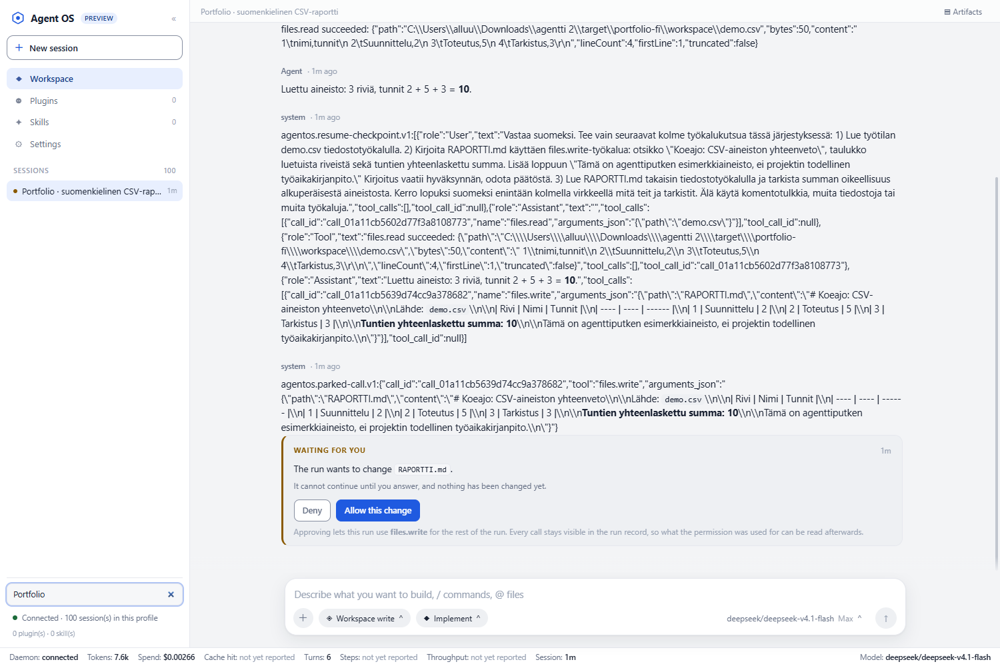
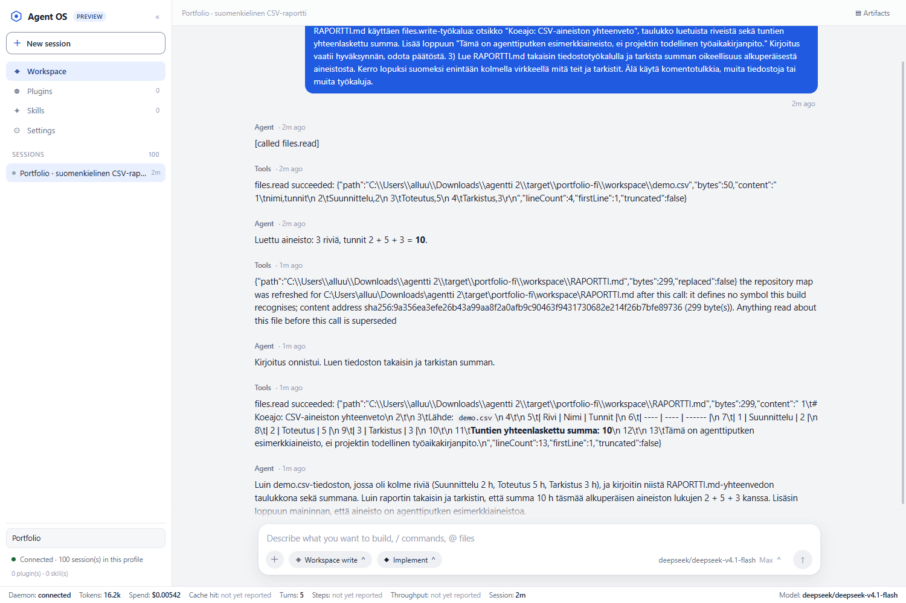

# Historiallinen työnäyte — Agent OS (8.10.2026)

> **Huomio:** Tämä hakemisto säilyttää projektin ensimmäisen julkisen prototyypin (**Agent OS**) sellaisenaan vertailukohtana sille, miten järjestelmä on kehittynyt kahdessa kuukaudessa nykyiseksi **Hexel OS** -kokonaisuudeksi ([takaisin pääesittelyyn](../README.md)).

## Mitä tässä ensimmäisessä työnäytteessä tehtiin

Lokakuun 2026 koeajo toteutettiin ensimmäisellä selainkäyttöliittymällä ja paikallisella Rust-taustapalvelulla (`deepseek/deepseek-v4.1-flash`, provider `openrouter`). Tavoitteena oli todentaa agenttiputken ensimmäinen päästä päähän toimiva versio:

1. Agentti luki kolmen rivin CSV-esimerkkiaineiston ([demo.csv](demo.csv)).
2. Ennen levylle kirjoittamista ajo pysähtyi odottamaan ihmisen hyväksyntää (`files.write`).
3. Hyväksynnän jälkeen agentti loi tiedoston [RAPORTTI.md](RAPORTTI.md) (299 tavua), luki sen takaisin ja varmisti summan (`2 + 5 + 3 = 10`).

| Hyväksyntäportti (Agent OS v1) | Valmis koeajo (Agent OS v1) |
| --- | --- |
|  |  |

Alkuperäiset koeajon tekniset tiedot (8.10.2026)

- **Ajon tunniste:** `01a11cb5-6be2-74da-aa36-86a235cb4c94` (`completed`, `2026-10-08T18:10:14Z` – `2026-10-08T18:11:41Z`)
- **Raportoitu käyttö:** 15 534 syötetokenia, 630 tulostokenia (`0,0054162 USD`)
- **Mitä puuttui vielä silloin:** Käyttöliittymässä näkyivät vielä raa'at `system`-tarkistuspisteet, eikä live-esikatselua, selaintestausta (`browser.check`), `Researcher`-tilaa, MCP/Plugin-laajennuksia tai erillistä terminaaliagenttia vielä ollut. Nämä kaikki rakentuivat päälle seuraavan kahden kuukauden aikana **Hexel OS:ssä**.

